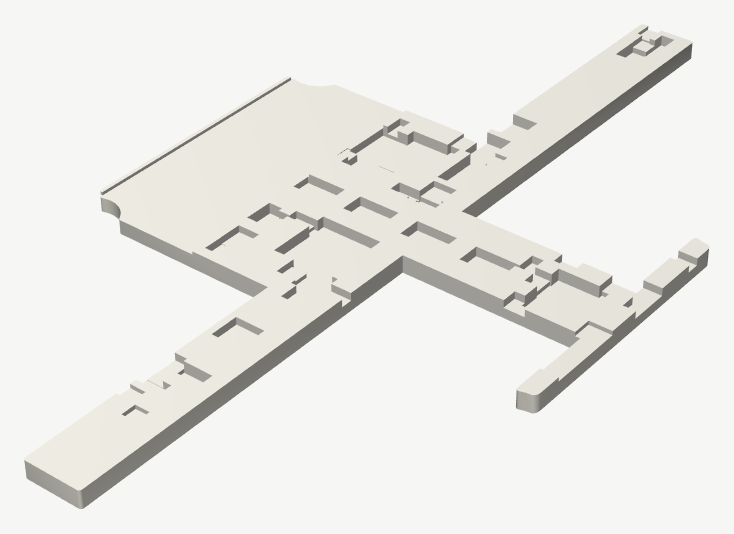

# SOLAR-GLOW DRH — Resin Diffuser Brace

Rendered from the committed STL by `enclosure/assembly_render.py`, in the same CI job that
rebuilds that STL from the board. Until 2026-07-29 this image had **no generator at all** — it
shipped in the initial import — so while the brace was respun against the real board it went on
showing the *old* one: the straight middle band that put 593 mm³ of resin inside SC1/SC3/SC4. It
now cannot go stale without the STL going stale with it.

A printed resin insert that drops into the titanium back-shell cavity, on top of the populated back of
the PCB. It is **not fastened and not bonded** — it is held by the shell clamping down, and it lifts
straight out. Its footprint is **computed from the board** (`enclosure/fit_rules.py`), not hand-placed: it was
a middle band plus two full-length outboard rails until 2026-07-29, when measurement showed that band drove
**593 mm³ of solid resin through SC1, SC3 and SC4** — it was sized for 28.5 mm WS17 cells and SC1/SC3 are
39 mm SS17. The footprint now subtracts every part it cannot span, sized so all
**four flat cavity walls are contacted** (~0.05 mm) for a no-rattle seat. The four corner bosses and the
rounded corners are **relieved** (cut clear — the brace need not fit them). It does three jobs — and
no longer does a fourth:

1. **Center support** — the brace props the thin board wherever a part does not stand in the way (so the shell floor can be a true 1.00 mm with no internal ribs): one spine between the two cap pairs, wall to wall, and a band across the cap gap. It reaches **33% of the cavity floor** (the generator prints the exact figure on every run — 1313.6 mm² / 33.0% on the 2026-11-12 board; this line said 1385 mm² / 34.6% from the 07-29 respin, then froze 1374.5 mm² / 34.4% on 2026-08-01 inside the very sentence explaining that it had stopped freezing numbers). The ceiling is 38.5%: the supercaps are 1.70 mm tall in a 1.80 mm cavity and occupy 58.8% of the floor, so nothing can ever span them. It is deliberately **one piece** — a loose part in an assembly that must come apart for C9 NFC trim is a thing to lose and a thing to reassemble wrong. **That choice now costs four pieces, not one:** 202.6 mm², 5.1 points of coverage (it was one ~85 mm² island east of SC4, 2.1 points, when this was written), and the four it drops are the outboard rails — see below. `fit_rules.DROPPED_AREA` records the area rather than hiding it; `fit_rules.DROPPED` is the pieces themselves.
2. **Window backing** — a solid white face behind the FR4 monogram window turns the four reverse-mount LEDs into an even amber lightbox.
3. **NFC ferrite carrier** — an open channel over the coil holds a ferrite strip that lifts the antenna off the grounded titanium.

**It does not back the solar-cell solder tabs.** That was job 2 on this list — _"the rails sit directly behind the four
solar-cell solder tabs, so pressing a cell down lands cell → board → brace → titanium instead of flexing the bare 0.6 mm
FR4"_ — and the list went on saying so for three months after it stopped being true. On the committed board the four tab
lands (`PV1` / `PV2`, pads `Nt` and `Pt`: x 4.30 and 46.50, y 15.75 and 73.15, each 4.0 × 3.0 mm) have **no resin behind
them at all**. The nearest brace material is 14.1–15.5 mm from a tab's centre, on the max brace and the lite alike.

- **How it went**, rebuilt from each commit's own board and rules. **Three of four** were backed from the 2026-07-29
  respin; the fourth, PV2's east tab, never was — its rail *was* the "island east of SC4" the one-piece rule dropped that
  day. **One** after the 2026-08-07 centre consolidation, which moved the caps outboard and traded the legs away on
  purpose (`scripts/check_mesh.py` records it: "leg area traded to the horizontal cap scoots by design"). **None** since
  the LDO island went in on 2026-08-08.
- **The rails are still computed** — four outboard strips, 36–66 mm² each — but each is cut off from the body by the
  reliefs round a corner boss and a mid-edge boss, and job 1's one-piece rule drops all four.
- **What is behind a tab instead**, measured on the same board: of each 12 mm² land, 3.0–3.6 mm² is over a supercap can,
  0.6 mm² of the two west lands is over the shell's lip (none of the east), and **6.1–8.5 mm² is over nothing** — bare
  0.6 mm FR4 spanning the 2.6–2.7 mm (west) or 3.9–4.0 mm (east) between the can and the lip. (2.9 mm² of PV1's east land is
  over JP1, which is bare copper pads, not a body.)
- **Where it is computed.** The drawing generator works it out from the board on every run and prints it —
  `tabs backed 0/4 (nearest resin 14.07-15.50 mm from a tab centre; the 4 dropped piece(s), 202.6 mm2, would back 4)` —
  and the sheet's plan, legend and note 4 say the same. Until 2026-11-12 its tab positions were four typed points,
  each 1.25 mm off its land, typed again into the brace CAD's pocket map (`board_parts.cell_tab_lands()` reads the
  lands off the board for both now), and the plan still labelled a "W LEG" and an "E LEG".

Whether the tabs should be backed again — the four rails as separate printed pieces, a bridge past the mid-edge bosses,
or nothing — is DRH's call, and is listed in `TODO.md`.

> **Source of truth.** `solar-glow-drh-diffuser-brace-cad.py` is authoritative. It reads
> `PCB/solar-glow-drh-v4_0.kicad_pcb`, subtracts every B-side footprint at its verified height, and
> writes the STEP/STL. Re-run it if the board **or the shell cavity** changes; the brace is a reprint.

## Files

| File | Purpose |
|---|---|
| `solar-glow-drh-diffuser-brace-cad.py` | Parametric CadQuery generator. **Source of truth.** |
| `solar-glow-drh-diffuser-brace.step` | Solid model. |
| `solar-glow-drh-diffuser-brace.stl` | **Print this.** SLA mesh. |
| `solar-glow-drh-diffuser-brace-DRAWING.pdf` / `.png` | Print/spec sheet: board-facing plan + Section B-B + material, ferrite, fit, and assembly notes. |
| `solar-glow-drh-diffuser-brace-pocket-map.png` | Debug map: every pocket over the board outline, the four solar-cell tab lands (read off the board; none is backed), and the merged thin-wall bridges. |

## Material and printing

- **Process:** SLA / resin print. **Material must be opaque-white and non-conductive** — no carbon- or graphite-filled resin (the brace rests directly on GND / VS / signal copper, and white drives the window backing).
- **Height fit:** print ~0.1 mm proud, then **sand the flat bottom (the datum)** to a zero-air fit in **the variant's cavity** — 1.80 mm for the max brace, 1.22 mm for the lite brace (`…-brace-lite.*`; `fit_rules.VARIANTS` owns both numbers, 2026-08-07). Every pocket is on the **top** face, so the bottom laps flat on glass. **Do not sand the top** — it sets the pocket depths.
- **Wall fit:** the four outer edges are sized **0.05 mm inside the cavity walls** (contact, no rattle). If the print comes out tight, lightly sand the outer edges the same way as the bottom — **do not touch the four corner reliefs**.
- Envelope **47 × 85 × 1.80 mm**; volume ~2.6 cm³, mass ~3.0 g (tough white SLA).

## Geometry — precision fit

- **Contacts all four flat walls at ~0.05 mm**, wherever the footprint reaches them: west edge x2.55 (wall x2.50), south edge y2.05 (wall y2.00), north edge y86.85 (wall y86.90), east edge **x49.50 (wall x49.55)**. The east wall is the shell's 1.25 mm lip — one band the whole length of the card, set by the 1.00 mm standoff from NFC coil copper (`fit_rules.COIL_CLR`). _(Until 2026-11-12 this bullet put the east wall at x49.75 with a step at y10, and the brace agreed with it: it was cut from the scalar rectangle `fit_rules._CAV` and came out 0.20 mm wider than the cavity the shell actually has, over y 31–58 — found by measuring the committed STEPs. The brace is cut from `fit_rules.brace_cavity()` now, and `scripts/assembly_drc.py` [B] compares the emitted brace with the emitted shell instead of with that rectangle. The other three walls in the old text were each 0.05 out as well.)_
- **The ridge east of the ferrite channel is 0.40 mm wide** (was 0.65), 0.33 mm tall, under the 0.60 mm `SLA_WALL` figure — the channel wall stayed at x49.10 when the brace's edge moved to x49.50. Measured on both built braces. Whether to narrow the channel clearance, open that side, or accept it is open in `TODO.md`.
- **Corner bosses relieved.** A circular relief (r3.0) at each of the four M2 bosses (r2.6) clears the boss **and** the rounded cavity corner; the brace does not seat on them, only on the flat walls.
- **No outboard rails.** The caps sit in two open bays either side of the spine (SC1/SC3 x5.1–22.2, SC2/SC4 x28.5–45.7), with a **directional gap since 2026-08-23** — the caps are HAND-SOLDERED, so they get a per-EDGE in-plane clearance (`fit_rules.CLR_DATUM` 0.25 / `CLR_FREE` 0.75) rather than the flat 0.25 mm every machine-placed part gets. The reflow shim indexes two edges of each cap, so those hold machine-placed tolerance while the two free edges absorb the can's own +0.50 mm body tolerance — which is the real driver, not hand slop. A brief uniform-0.75 round cost 111 mm² of footprint; going directional gave back 101.9 of it (max brace 33.01% coverage, one piece). The narrowest web does NOT come back: the pinch at (3.45, 32.33) is on SC1's west, a FREE edge, so it holds 1.80 mm (was 2.28)) Outboard of the caps the computation still yields a strip on each side of each cell, and drops all four (job 1): **nothing backs the PV solder tabs**. _(Until 2026-11-12 this bullet read "Rails run the full length (y2.10–86.80) outboard of the supercaps (SC1/SC3 x7–24, SC2/SC4 x26.8–43.8 …) … the rails back the four PV solder tabs".)_
- **Band fills the cap gap** (y31.15–57.75), full width x2.60–49.70, carrying the window backing and the ferrite channel.
- **Corners relieved to the as-milled radius.** The shell is milled, so its internal concave corners (the 4 boss-to-wall junctions and the 2 east pinch/widen steps) carry the finisher's R1.0 radius, which the sharp STEP does not show. The brace footprint is clipped to the tool-reachable cavity, backing each of those corners off by R1.0 so it clears the real metal while the flat-wall contact stays at 0.05 mm.

## Key features

- **Flat bottom = datum.** The board-facing (top) face carries all the pockets; the shell-facing (bottom) face is flat and is the sanding reference.
- **Ferrite channel** over the NFC coil: an **open-ended** channel — walled on the **12 mm width** (edge-limited by the coil/board east edge), **open at both ends** (length is forgiving), **0.33 mm** deep. Takes a Würth WE-FSFS 364006 ferrite, nominal **12 × 26 mm**, PSA'd in; it may overhang the ends slightly.
- **Window = LED-hug diffuser backing:** solid white resin fills the monogram-window footprint behind the FR4, minus tight D2–D5 LED pockets. No aperture, no floor tape.
- **U6 is a through-pocket.** U6 (1.45 mm) is forced through because a blind pocket would leave a sub-0.4 mm resin ceiling; through, its body faces the shell floor with 0.35 mm of air. Everything else sits in blind pockets at its verified height.
- **Thin-wall bridges.** Where two pockets would leave a resin wall thinner than 0.40 mm, the generator merges the pair into one recess. It prints the merged-pair count when run (they cluster in the dense areas); the regenerated STEP/STL reflect the current board (the count shifts as parts move - C10 was removed and the v3 clamp cluster deleted).

## Removable — keep it that way during bring-up

The brace must lift out for the NFC **C9 rework path** during bench bring-up. (Procedure updated
2026-08-01: C9 is a **derived 47 pF, fitted at assembly** — not the bare-card-trim-then-re-trim of the
old plan. The bring-up check is done ENCLOSED; only if the measured resonance lands outside the
~13.6–15.3 MHz window does C9 get swapped along its same-series ladder — and that swap is what the
brace must come out for.) Keep it a **dry fit** while iterating; add any optical gel only on the final
card, and re-apply it on every removal.

---

*Part of SOLAR-GLOW · DRH. © 2026 Devin R. Horowitz. MIT License (see `../../LICENSE`).*
