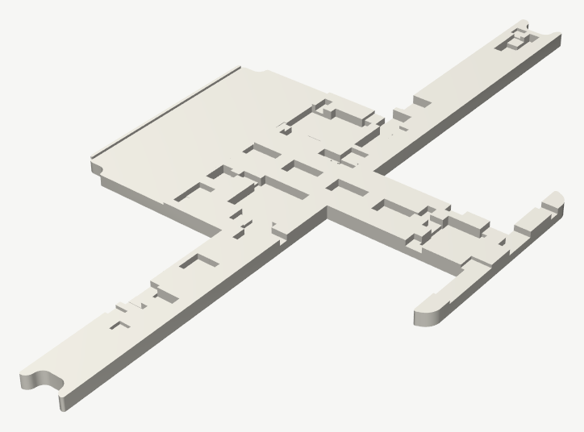

# SOLAR-GLOW DRH — Resin Diffuser Brace

Rendered from the committed STL by `enclosure/assembly_render.py`, in the same CI job that
rebuilds that STL from the board. Until 2026-07-29 this image had **no generator at all** — it
shipped in the initial import — so while the brace was respun against the real board it went on
showing the *old* one: the straight middle band that put 593 mm³ of resin inside SC1/SC3/SC4. It
now cannot go stale without the STL going stale with it.

A printed resin insert that drops into the titanium back-shell cavity, on top of the populated back of
the PCB. It is **not fastened and not bonded** — it is held by the shell clamping down, and it lifts
straight out. Its footprint is **computed from the board** (`enclosure/fit_rules.py`), not hand-placed: it was
a middle band plus two full-length outboard rails until 2026-07-29, when measurement showed that band drove
**593 mm³ of solid resin through SC1, SC3 and SC4** — it was sized for 28.5 mm WS17 cells and SC1/SC3 are
39 mm SS17. The footprint now subtracts every part it cannot span, sized so all
**four flat cavity walls are contacted** (~0.05 mm) for a no-rattle seat — and, since 2026-11-15, so is
everything else of the shell it reaches: it **nests against the four mid-span bosses** and its long arm
**runs either side of the two short-edge tabs**, all at that one fit (the section on geometry has what that
asks of the print). The four corner bosses are not reached. It does three jobs — and no longer does a fourth:

1. **Center support** — the brace props the thin board wherever a part does not stand in the way (so the shell floor can be a true 1.00 mm with no internal ribs): one spine between the two cap pairs, wall to wall, and a band across the cap gap. It reaches **33% of the cavity floor** (the generator prints the exact figure on every run — 1333.2 mm² / 32.8% since it nested on 2026-11-15, of a floor that now counts the void beside the supercaps out to the recess wall, 4062 mm² where it was 3913; 1313.6 mm² / 33.0% on the 2026-11-12 board; this line said 1385 mm² / 34.6% from the 07-29 respin, then froze 1374.5 mm² / 34.4% on 2026-08-01 inside the very sentence explaining that it had stopped freezing numbers). The ceiling is 38.5%: the supercaps are 1.70 mm tall in a 1.80 mm cavity and occupy 58.8% of the floor, so nothing can ever span them. It is deliberately **one piece** — a loose part in an assembly that must come apart for C9 NFC trim is a thing to lose and a thing to reassemble wrong. **That choice now costs four pieces, not one:** 202.6 mm², 5.1 points of coverage (it was one ~85 mm² island east of SC4, 2.1 points, when this was written), and the four it drops are the outboard rails — see below. `fit_rules.DROPPED_AREA` records the area rather than hiding it; `fit_rules.DROPPED` is the pieces themselves.
2. **Window backing** — a solid white face behind the FR4 monogram window turns the four reverse-mount LEDs into an even amber lightbox.
3. **NFC ferrite carrier** — an open channel over the coil holds a ferrite strip that lifts the antenna off the grounded titanium.

**It does not back the solar-cell solder tabs.** That was job 2 on this list — _"the rails sit directly behind the four
solar-cell solder tabs, so pressing a cell down lands cell → board → brace → titanium instead of flexing the bare 0.6 mm
FR4"_ — and the list went on saying so for three months after it stopped being true. On the committed board the four tab
lands (`PV1` / `PV2`, pads `Nt` and `Pt`: x 4.30 and 46.50, y 15.75 and 73.15, each 4.0 × 3.0 mm) have **no resin behind
them at all**. The nearest brace material is 14.1–15.5 mm from a tab's centre, on the max brace and the lite alike.

- **How it went**, rebuilt from each commit's own board and rules. **Three of four** were backed from the 2026-07-29
  respin; the fourth, PV2's east tab, never was — its rail *was* the "island east of SC4" the one-piece rule dropped that
  day. **One** after the 2026-08-07 centre consolidation, which moved the caps outboard and traded the legs away on
  purpose (`scripts/check_mesh.py` records it: "leg area traded to the horizontal cap scoots by design"). **None** since
  the LDO island went in on 2026-08-08.
- **The rails are still computed** — four outboard strips, 36–66 mm² each — but each is cut off from the body by the
  reliefs round a corner boss and a mid-edge boss, and job 1's one-piece rule drops all four.
- **What is behind a tab instead**, measured on the same board: of each 12 mm² land, 3.0–3.6 mm² is over a supercap can,
  0.6 mm² of the two west lands is over the shell's lip (none of the east), and **6.1–8.5 mm² is over nothing** — bare
  0.6 mm FR4 spanning the 2.6–2.7 mm (west) or 3.9–4.0 mm (east) between the can and the lip. (2.9 mm² of PV1's east land is
  over JP1, which is bare copper pads, not a body.)
- **Where it is computed.** The drawing generator works it out from the board on every run and prints it —
  `tabs backed 0/4 (nearest resin 14.07-15.50 mm from a tab centre; the 4 dropped piece(s), 202.6 mm2, would back 4)` —
  and the sheet's plan, legend and note 4 say the same. Until 2026-11-12 its tab positions were four typed points,
  each 1.25 mm off its land, typed again into the brace CAD's pocket map (`board_parts.cell_tab_lands()` reads the
  lands off the board for both now), and the plan still labelled a "W LEG" and an "E LEG".

**Not backed, by decision** (DRH, 2026-11-13): the air frame has no brace at all, so the card has to tolerate unbacked
tabs regardless. The first-article bench list in `TODO.md` carries the press test that proves it; if a joint cracks, the
options passed over come back — the four rails as separate printed pieces, or a bridge past each mid-edge boss.

> **Source of truth.** `solar-glow-drh-diffuser-brace-cad.py` is authoritative. It reads
> `PCB/solar-glow-drh-v4_0.kicad_pcb`, subtracts every B-side footprint at its verified height, and
> writes the STEP/STL. Re-run it if the board **or the shell cavity** changes; the brace is a reprint.

## Files

| File | Purpose |
|---|---|
| `solar-glow-drh-diffuser-brace-cad.py` | Parametric CadQuery generator. **Source of truth.** |
| `solar-glow-drh-diffuser-brace.step` | Solid model. |
| `solar-glow-drh-diffuser-brace.stl` | **Print this.** SLA mesh. |
| `solar-glow-drh-diffuser-brace-DRAWING.pdf` / `.png` | Print/spec sheet: board-facing plan + Section B-B + material, ferrite, fit, and assembly notes. |
| `solar-glow-drh-diffuser-brace-pocket-map.png` | Debug map: every pocket over the board outline, the four solar-cell tab lands (read off the board; none is backed), and the merged thin-wall bridges. |

## Material and printing

- **Process:** SLA / resin print. **Material must be opaque-white and non-conductive** — no carbon- or graphite-filled resin (the brace rests directly on GND / VS / signal copper, and white drives the window backing).
- **Printer class: one that holds 0.25 mm walls** (`fit_rules.PRINT_WALL`, which the generator holds the ferrite channel's ridge to) — a Formlabs Form 3 / Form 4-class SLA or equivalent, ~50 µm layers (DRH's decision, 2026-11-13). The brace keeps four features thinner than the 0.60 mm `SLA_WALL` it is otherwise opened to, on purpose (next section): the 0.40 mm ridge east of the ferrite channel, 0.265–0.52 mm stretches on its west side, and a 0.46 mm diagonal neck between the TP2 and TP3 pockets. Every one is joined to the brace along its base, and the channel walls are only 0.33 mm tall. Formlabs' current Form 4 design guide gives 0.2 mm as the minimum for supported and unsupported walls alike (Grey Resin, 50 µm), while its older Form 2 figures were 0.6–0.8 mm — so **a service on older equipment is not acceptable for this part**. Name the class in the order.
- **Height fit:** print ~0.1 mm proud, then **sand the flat bottom (the datum)** to a zero-air fit in **the variant's cavity** — 1.80 mm for the max brace, 1.22 mm for the lite brace (`…-brace-lite.*`; `fit_rules.VARIANTS` owns both numbers, 2026-08-07). Every pocket is on the **top** face, so the bottom laps flat on glass. **Do not sand the top** — it sets the pocket depths.
- **Wall fit:** the outline is sized **0.05 mm inside the shell on every face it reaches** (contact, no rattle; `fit_rules.WALL_FIT`). If the print comes out tight on a **flat** edge, lightly sand that edge the same way as the bottom.
- **The nested curves cannot be sanded to fit, so the print has to be right** (DRH, 2026-11-15: "let's try to make a somewhat exact fit, since these are complex curves that would be hard to sand out of the plastic"). The outline follows each mid-span boss and wraps each short-edge tab at the same 0.05 mm, and most of that is inside a fork or a hollow that no sanding block reaches. **What decides whether it drops in is the printer's scale along the brace's length**, because the two forks are at opposite ends of it: their seats are **84.80 mm apart**, and 0.05 mm at each is 0.10 mm in all — 0.12 %. Formlabs' own figure for a Form 4 (*Design specifications for 3D models, Form 4 generation*: Grey Resin V5, 100 µm) is ±0.3 % with a lower limit of ±0.15 mm for an 81–150 mm feature, ±0.2 % (±0.06 mm) for 31–80 mm and ±0.15 % (±0.02 mm) for 1–30 mm. So **a print inside the printer's own specification can be 0.25 mm long, and will not seat** — where the 26.90 mm the ferrite block spans between the two east bosses (±0.04) and each fork's own slot, 3.6 mm at its widest (±0.02), are comfortably inside it. This was true of the square-ended arm as well, which stood 0.05 mm off each tab's tip; the difference is that a square end can be sanded. **Expect to measure the first print and correct the printer's XY scale** (seat to seat between the two forks, 84.80 nominal, or 88.70 over the prongs' noses; `TODO.md` has the bench item), then reprint. If a looser nest is wanted instead, it is one constant; see the note under *Geometry*.
- Envelope **47.2 × 88.7 × 1.80 mm** (it was 84.8 long until the arm ran beside the tabs); the generator prints the volume and mass on every run.

## Geometry — precision fit

- **Contacts all four flat walls at ~0.05 mm**, wherever the footprint reaches them: west edge x2.30 (wall x2.25), the two tab tips at y2.05 and y86.85 (tips at y2.00 and y86.90), east edge **x49.50 (wall x49.55)**. _(The west figures read x2.55 / x2.50 here until 2026-11-15; the west lip has been 2.25 wide since the simpler-cuts pass of that day and this line was not moved with it.)_ The east wall is the shell's 1.25 mm lip — one band the whole length of the card, set by the 1.00 mm standoff from NFC coil copper (`fit_rules.COIL_CLR`). _(Until 2026-11-12 this bullet put the east wall at x49.75 with a step at y10, and the brace agreed with it: it was cut from the scalar rectangle `fit_rules._CAV` and came out 0.20 mm wider than the cavity the shell actually has, over y 31–58 — found by measuring the committed STEPs. The brace is cut from `fit_rules.brace_cavity()` now, and `scripts/assembly_drc.py` [B] compares the emitted brace with the emitted shell instead of with that rectangle. The other three walls in the old text were each 0.05 out as well.)_
- **The ridge east of the ferrite channel is 0.40 mm wide** (was 0.65), 0.33 mm tall, under the 0.60 mm `SLA_WALL` figure — the channel wall stayed at x49.10 when the brace's edge moved to x49.50. Measured on both built braces. **It ends square, at y 31.45 and y 57.46, where it is 0.25 wide** (2026-11-14; those two figures were 31.67 and 57.23 until the east bosses were cut straight the next day, and this line kept the old pair): until then it followed the brace's edge round each boss fillet and tapered to nothing, two feather tips found by measuring the built parts. The channel now runs out to the brace's edge wherever the ridge would be under `fit_rules.PRINT_WALL`, and `scripts/assembly_drc.py` [C] measures the result. The 12 × 26 ferrite (y 31.5–57.5) ends 0.05 mm inside the ridge at one end and 0.04 mm past it at the other; the channel was always open-ended. **Accepted as is (DRH, 2026-11-13)**, with the channel's west-side walls and the TP2/TP3 neck: they are what locates the ferrite's critical width, and the print-spec bullet above names the printer class that holds them.
- **Nested against the bosses, and round the tabs — since 2026-11-15** (DRH: "I want the brace to get a tighter fit, matching the inverse at the ferrite side such that the plastic nests along the curve of the bosses", and "on the northern and southern tabs, I want the brace extended such that it hugs either side of the tabs along that curve"). The outline is the shell's void **as milled**, inside the recess wall, less `WALL_FIT` — nothing else (`fit_rules.brace_cavity()`). So it is the inverse of whatever it reaches:
  - **the two east mid-span bosses** (the ferrite side): the block lies along each boss's straight cut and follows the round at its corner, where it used to stand 0.32 mm off the corner and 0.53 mm off the cut. +2.0 mm² at each;
  - **the two west mid-span bosses**: the arm's end pads follow each boss's circle and the round at its corner, +0.25 mm² at each (they already lay along the R2.00 blends);
  - **the two short-edge tabs**: the long arm no longer stops square against a tab's tip. It runs on as a prong on either side, following the tip's round, the side and the root's curve, and ends in an R0.30 nose at the recess wall. The prongs are 1.04 to 1.41 mm wide beside the tab — whatever the supercap's bay leaves — and the two wider ones (east of each tab) follow the whole root to the wall; the two narrower ones follow 83° and 77° of its 90° and stop 0.06 and 0.09 mm short, where they would be thinner than `SLA_WALL`. +4.6 mm² at one end and +4.7 at the other.

  Max footprint 1319.3 → 1333.2 mm², lite 1089.8 → 1103.8. **What went:** a circle of `fit_rules.RELIEF_R` (r2.85, boss r2.60 + `CLR`) cut round all eight boss axes — a full round boss's shape, typed before two of the bosses were cut straight — and the rectangle `fit_rules.cavity_rect()`, whose short edges were the tab tips. Both are still what `brace_footprint(nest=False)` gives, and `scripts/reflow_shim.py` asks for that: the shim lies on the bare board, with no shell round it. **What did not move:** the eight floor fillets. The prongs stand over the last 0.2 mm of four of their walls, 0.17 mm and more from where a fillet has already ended in its scoop; `fit_rules.floor_runs()` now asks whether a brace is near a run's own metal, where it used to ask about the whole stretch of wall. **If a looser nest is wanted:** `brace_cavity()` shrinks the void by one number. A second, larger one for the curves alone would put a step in the outline wherever a curve meets a flat, so the choice is one fit everywhere or a different outline rule — say which.
- **No outboard rails.** The caps sit in two open bays either side of the spine (SC1/SC3 x5.1–22.2, SC2/SC4 x28.5–45.7), with a **directional gap since 2026-08-23** — the caps are HAND-SOLDERED, so they get a per-EDGE in-plane clearance (`fit_rules.CLR_DATUM` 0.25 / `CLR_FREE` 0.75) rather than the flat 0.25 mm every machine-placed part gets. The reflow shim indexes two edges of each cap, so those hold machine-placed tolerance while the two free edges absorb the can's own +0.50 mm body tolerance — which is the real driver, not hand slop. A brief uniform-0.75 round cost 111 mm² of footprint; going directional gave back 101.9 of it (max brace 33.01% coverage, one piece). The narrowest web does NOT come back: the pinch at (3.45, 32.33) is on SC1's west, a FREE edge, so it holds 1.80 mm (was 2.28)) Outboard of the caps the computation still yields a strip on each side of each cell, and drops all four (job 1): **nothing backs the PV solder tabs**. _(Until 2026-11-12 this bullet read "Rails run the full length (y2.10–86.80) outboard of the supercaps (SC1/SC3 x7–24, SC2/SC4 x26.8–43.8 …) … the rails back the four PV solder tabs".)_
- **Band fills the cap gap**, full width x2.30–49.50, carrying the window backing and the ferrite channel: y29.77–59.15 between the supercaps' bays, y30.90–58.00 between the two east bosses, y40.25–48.65 where it runs out to the west wall. _(This line read "y31.15–57.75 … x2.60–49.70" until 2026-11-15 — the 28.5 mm WS17 bay ends and two walls that have each moved since.)_
- **Corners relieved to the as-milled radius — since 2026-11-13, and not before.** The shell is milled, so its internal concave corners carry the finisher's R1.0, which the sharp STEP does not show. The brace is cut to `fit_rules.cavity_as_milled()` — the cavity opened by that radius — so it clears the real metal while the flat-wall contact stays at 0.05 mm, and `scripts/assembly_drc.py` [H] holds the emitted brace to the emitted shell with the radius applied. **Since 2026-11-14 the shell models those junctions** (`fit_rules.boss_blends()`), and the brace follows whatever is there: at the two WEST bosses beside its band it is cut back to an R2.00 blend, 0.47 mm² of footprint in all; at the two east ones the blend is held to R1.00 by the ferrite sheet, so those corners — and the ridge east of the channel — are exactly where they were. _(This bullet said that much for months and it was false: the brace was cut to the sharp cavity, and at the four boss-to-wall corners beside its band it ran 0.225 mm (east) and 0.055 mm (west) into the fillets the Ø2.0 leaves — found by sectioning the committed STLs with the radius applied. The "2 east pinch/widen steps" it named did not exist either: the east wall has been one 1.25 mm band since the coil clamp.)_

## Key features

- **Flat bottom = datum.** The board-facing (top) face carries all the pockets; the shell-facing (bottom) face is flat and is the sanding reference.
- **Ferrite channel** over the NFC coil: an **open-ended** channel — walled on the **12 mm width** (edge-limited by the coil/board east edge), **open at both ends** (length is forgiving), **0.33 mm** deep. Takes a Würth WE-FSFS 364006 ferrite, nominal **12 × 26 mm**, PSA'd in; it may overhang the ends slightly.
- **Window = LED-hug diffuser backing:** solid white resin fills the monogram-window footprint behind the FR4, minus tight D2–D5 LED pockets. No aperture, no floor tape.
- **U6 is a through-pocket.** U6 (1.45 mm) is forced through because a blind pocket would leave a sub-0.4 mm resin ceiling; through, its body faces the shell floor with 0.35 mm of air. Everything else sits in blind pockets at its verified height.
- **No resin wall under `SLA_WALL` (0.60 mm), in two passes.** Where two pockets would leave a wall thinner than that between them, the generator merges the pair into one recess. Then every level of the brace — each band of height where the set of pockets is constant — is opened at 0.60, which also takes the walls the pair pass never compared: a pocket against a supercap bay, a through-cut or the brace's own outline. It prints both counts when run; they shift as parts move. _(Until 2026-11-13 this was the pair pass alone, at 0.40, and it left 0.0068 mm of resin between C24's pocket and SC3's bay — found by measuring the built braces.)_ The one exception is deliberate: the ferrite channel is cut after the levels, so its own walls stay — the 0.40 mm ridge above and three stretches on its west side, 0.265–0.52 mm wide, all 0.33 mm tall — because the channel's width is what locates the ferrite.

## Removable — keep it that way during bring-up

The brace must lift out for the NFC **C9 rework path** during bench bring-up. (Procedure updated
2026-08-01: C9 is a **derived 47 pF, fitted at assembly** — not the bare-card-trim-then-re-trim of the
old plan. The bring-up check is done ENCLOSED; only if the measured resonance lands outside the
~13.6–15.3 MHz window does C9 get swapped along its same-series ladder — and that swap is what the
brace must come out for.) Keep it a **dry fit** while iterating; add any optical gel only on the final
card, and re-apply it on every removal.

---

*Part of SOLAR-GLOW · DRH. © 2026 Devin R. Horowitz. MIT License (see `../../LICENSE`).*
